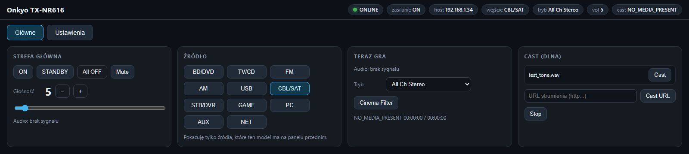
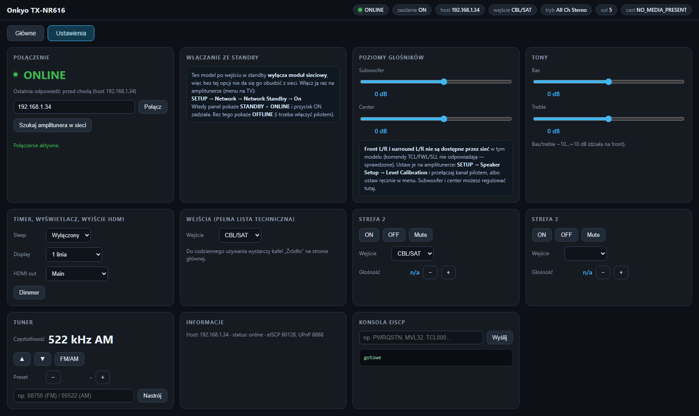

# Onkyo TX-NR616 Web Panel 🎛️

**Sterowanie amplitunerem Onkyo z przeglądarki** — pełny panel WWW (eISCP) z dodatkowym
**castowaniem audio po DLNA** (amplituner jako renderer, jak Chromecast).

Zrobione i przetestowane na żywo na **Onkyo TX-NR616** (firmware 2012), ale protokół eISCP
jest wspólny dla wielu amplitunerów Onkyo — panel powinien działać też na innych modelach
(z listą dostępnych funkcji zależną od modelu).





## Funkcje

**Zakładka „Główne"**
- ON / STANDBY / All OFF, mute
- głośność 0–100 (suwak reaguje natychmiast + krok ±)
- **kafle źródeł** (tylko realne wejścia modelu: BD/DVD, CBL/SAT, STB/DVR, GAME, PC, AUX, AM, FM, TV/CD, NET, USB)
- „Teraz gra": format, kanały, tryb nasłuchu, Cinema Filter
- **Cast DLNA**: pliki z folderu + dowolny URL strumienia

**Zakładka „Ustawienia"**
- status **ONLINE/OFFLINE** + czas ostatniej odpowiedzi
- **wyszukiwanie amplitunera w sieci** (SSDP + skan portu 60128), ręczne IP, zapis w `config.json`
- instrukcja **Network Standby** (żeby dało się włączać ze standby)
- poziomy: subwoofer, center; tony bas/treble
- sleep, dimmer, tryb wyświetlacza, wyjście HDMI
- strefy 2 i 3 (zasilanie, wejście, mute, głośność)
- tuner FM/AM (strojenie ±, direct, presety)
- konsola eISCP (dowolna komenda)

**Silnik**
- jedno stałe połączenie eISCP do pollingu + osobne do komend → kliknięcia reagują w ~40 ms
- optymistyczna aktualizacja stanu (bez migotania starymi wartościami)
- wykrywanie urządzenia i zapamiętywanie adresu
- brak zewnętrznych zależności poza biblioteką standardową Pythona

## Wymagania

- Python **3.8+** (do uruchomienia bez Dockera)
- amplituner i komputer w tej samej sieci LAN
- porty **8770** (panel) i **8765** (serwer plików dla DLNA) wolne na hoście
- w amplitunerze najlepiej: stałe IP (rezerwacja DHCP) + `Network Standby = On`

## Szybki start (Windows)

```bat
start_panel.bat 192.168.1.34
```

albo ręcznie:

```powershell
python onkyo_web.py --host 192.168.1.34 --media "C:\Music" --ui-port 8770
# otwórz http://127.0.0.1:8770/
```

## Docker

```bash
docker compose up -d --build
# panel: http://IP-host:8770/
```

W `docker-compose.yml` ustaw własne IP amplitunera i katalog z muzyką.
`config.json` (zapamiętany adres) trzymany jest w `./config`.

## Unraid

1. skopiuj `onkyo_web.py`, `onkyo_cast.py` do `/mnt/user/appdata/onkyo-panel/`
2. zbuduj obraz i uruchom kontener (sieć host):

```bash
cd /mnt/user/appdata/onkyo-panel
docker build -t onkyo-panel:local .
docker run -d --name onkyo-panel --restart unless-stopped --network host \
  -e PYTHONUNBUFFERED=1 -e ONKYO_CONFIG=/config/config.json \
  -v /mnt/user/appdata/onkyo-panel:/app \
  -v /mnt/user/appdata/onkyo-panel/config:/config \
  -v /mnt/user/appdata/onkyo-panel/media:/media:ro \
  onkyo-panel:local --host 192.168.1.34 --media /media --ui-port 8770 --media-port 8765
```

3. (opcjonalnie) szablon do GUI Unraid: `unraid/onkyo-panel.xml` → `/boot/config/plugins/dockerMan/templates-user/`
4. autostart: dopisz `onkyo-panel` do `/var/lib/docker/unraid-autostart`

## Konfiguracja

| Parametr | Domyślnie | Opis |
|---|---|---|
| `--host` | `192.168.1.34` | IP amplitunera (albo z `config.json`) |
| `--media` | katalog bieżący | folder z plikami audio do castowania |
| `--ui-port` | `8770` | port panelu WWW |
| `--media-port` | `8765` | port serwera plików (musi być widoczny dla amplitunera) |
| `--bind` | `0.0.0.0` | adres nasłuchu (`127.0.0.1` = tylko lokalnie) |
| `ONKYO_CONFIG` (env) | `./config.json` | ścieżka pliku z zapamiętanym IP |

## Cast (DLNA)

Amplituner jest certyfikowanym rendererem DLNA (DMR-1.50), więc nie trzeba nic „hakować":
panel serwuje plik po HTTP i wysyła do amplitunera `SetAVTransportURI` + `Play`.

Obsługiwane formaty (z `ConnectionManager`): LPCM 44,1/48 kHz, MP3, WMA, AAC, WAV, FLAC, OGG.
**Pauza i przewijanie nie są obsługiwane przez ten DMR** — jest Play/Stop.

Zamiast panelu możesz też „castować" z telefonu aplikacjami typu **BubbleUPnP**, **Hi-Fi Cast**
albo z Windowsa („Przesyłaj do urządzenia").

## Co działa, a czego ten model nie ma

| Funkcja | Status |
|---|---|
| Zasilanie, wejścia, tryby, głośność, mute | ✅ |
| Tony bas/treble (front), poziom sub i center | ✅ |
| Strefy 2 i 3, tuner FM/AM, sleep, dimmer, HDMI out | ✅ |
| Cast DLNA (pliki, radio z URL) | ✅ |
| Wyszukiwanie urządzenia, status online | ✅ |
| Poziom **front L/R i surround L/R** przez sieć | ❌ — tylko menu OSD `Speaker Setup → Level Calibration` |
| Pauza / przewijanie DLNA | ❌ — renderer tego nie obsługuje |
| `ECO`, `CEC`, głośniki A/B, wersja firmware, test ton | ❌ — brak w firmware |

Szczegóły protokołu (ramki eISCP, formaty wartości, co odpowiada a co nie):
**[docs/PROTOCOL.md](docs/PROTOCOL.md)**

## Struktura

```
onkyo_cast.py        # klient eISCP + UPnP/DLNA + CLI (status/play/volume/input...)
onkyo_web.py         # panel WWW (serwer HTTP + UI + API)
start_panel.bat      # launcher Windows
Dockerfile           # obraz dla Dockera
docker-compose.yml   # gotowy compose
unraid/onkyo-panel.xml  # szablon kontenera dla Unraid
docs/PROTOCOL.md     # notatki protokołu eISCP/DLNA
```

## Rozwiązywanie problemów

- **Po standby nie da się włączyć** → włącz `SETUP → Network → Network Standby → On`
  (bez tego moduł sieciowy gaśnie i nic go nie obudzi).
- **OFFLINE, ale amplituner gra** → zmienił IP: kliknij „Szukaj amplitunera w sieci".
- **Cast się nie zaczyna** → sprawdź, czy port 8765 jest osiągalny z amplitunera (firewall),
  czy plik jest w obsługiwanym formacie i czy PC nie jest w innej podsieci.
- **Panel „muli"** → upewnij się, że nie masz dwóch instancji na tym samym porcie.
- **Porty znikają po lawinie połączeń** → restart modułu sieciowego (standby → on);
  panel sam się reconnectuje.

## Bezpieczeństwo

Panel (jak i sam amplituner) **nie ma uwierzytelniania** — każdy w LAN może sterować.
Uruchamiaj go tylko w zaufanej sieci; jeśli chcesz wystawić go dalej, postaw reverse proxy
z hasłem (np. SWAG) albo ustaw `--bind 127.0.0.1`.

## Licencja

MIT — patrz [LICENSE](LICENSE). Nazwa „Onkyo" należy do jej właściciela; projekt hobbystyczny,
niepowiązany z producentem.
